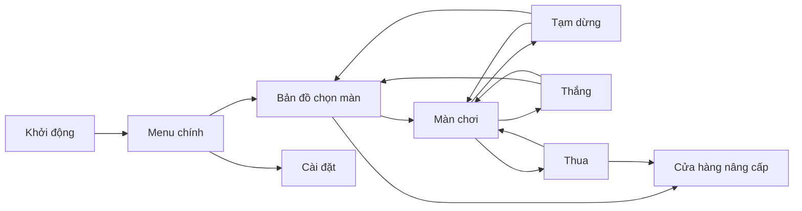

# Pup Launch — Tài liệu thiết kế game

> Bản 6 · 11/11/2026 · chỉ phát hành Android · **màn hình ngang** · Tên tiếng Việt tạm: **Hải Cẩu Bay** · Bối cảnh: biển băng vùng cực

Game 2D hành động vật lý trên biển băng: trong hố băng, máy đập của ông hải mã đánh từng hải cẩu con đang đu dây bay lọt khe thoát ở góc trên-phải, rồi người chơi điều khiển chúng cuộn tròn lao xuống phá pháo đài băng của bầy gấu bắc cực. Làm bằng Unity 6, hướng tới người chơi quốc tế.

| Mục | Nội dung |
|---|---|
| Tên tạm | Pup Launch (Hải Cẩu Bay). Tên mã trong code vẫn là `PufferLaunch` |
| Thể loại | Casual · vật lý · phá công trình |
| Engine | Unity 6.3 LTS · C# |
| Nền tảng | Chỉ Android (Google Play). Chơi thử trong Unity Editor hoặc máy ảo Android |
| Bản đầu (MVP) | 1 vùng · 10 màn · 4 nâng cấp |
| Ngôn ngữ | Tiếng Anh mặc định, tiếng Việt |

## Mục lục

1. [Tóm tắt](#1-tóm-tắt)
2. [Ý tưởng game](#2-ý-tưởng-game)
3. [Lối chơi](#3-lối-chơi)
4. [Nhân vật & vật liệu](#4-nhân-vật--vật-liệu)
5. [Nâng cấp & tiến trình](#5-nâng-cấp--tiến-trình)
6. [Các màn hình](#6-các-màn-hình)
7. [Công nghệ](#7-công-nghệ)
8. [Kiến trúc code](#8-kiến-trúc-code)
9. [Đồ họa & âm thanh](#9-đồ-họa--âm-thanh)
10. [Lộ trình](#10-lộ-trình)
11. [Phân công](#11-phân-công)
12. [Rủi ro](#12-rủi-ro)
13. [Bước tiếp theo](#13-bước-tiếp-theo)

---

## 1. Tóm tắt

Mỗi màn ngắn 30–90 giây, gồm hai pha. Pha đầu thử khả năng canh thời điểm: hải cẩu nào bay lọt khe thoát của hố băng thì thành "đạn". Pha sau là bắn vật lý kiểu artillery: điều khiển số đạn đó cuộn tròn lao xuống, phá khối tuyết, khối băng và hạ hết gấu. Thắng màn được 1–3 sao, dùng để mở nâng cấp. Màn ngắn và có sao nên người chơi dễ chơi lại để lấy điểm cao hơn.

### Vì sao chọn chủ đề này

- **Thân thiện mọi lứa tuổi:** hải cẩu con trắng mắt to dễ thương, gấu bắc cực là kẻ địch vui nhộn, không bạo lực.
- **Quốc tế:** băng tuyết, cực quang không gắn với văn hóa nước nào.
- **Hợp cơ chế:** hải cẩu tròn, cuộn lại thành quả bóng nên nảy và lăn tự nhiên.
- **Đẹp:** trời đêm cực quang, núi băng nhiều lớp, tuyết rơi, vẽ mềm có đổ bóng.

> **Về bản quyền:** game dùng cơ chế chung của thể loại "máy bắn + phá công trình" (bắn qua khe, lao xuống phá khối, nâng cấp bằng sao). Tên, nhân vật, bối cảnh, hình ảnh, âm thanh, giao diện và thiết kế màn đều là của riêng game này, không sao chép Crazy Penguin Catapult hay game nào khác. Nhân vật chính cố ý không dùng chim cánh cụt.

## 2. Ý tưởng game

### Bối cảnh

Bầy gấu bắc cực chiếm Vịnh Băng Giá và giấu hết cá dự trữ mùa đông của làng hải cẩu vào các pháo đài xây bằng tuyết và băng. Hai con cú tuyết canh cổng vào vịnh. Bầy hải cẩu con nhờ ông Hải Mã tung mình qua cổng từng con một để giành lại cá.

### Nhân vật

- **Pip:** hải cẩu con lông trắng, mắt đen to, đội mũ len đỏ có quả bông, kính phi công trên mũ, khăn quàng xanh ngọc. Đứng và đi bằng hai chân sau, khi lao xuống thì cuộn tròn thành quả bóng tuyết. Vẽ từng frame (không ghép bộ phận): sheet tạo bằng ChatGPT lưu ở `Assets/Art/Reference/`, cắt bằng `Tools/slice_sheets.py`. Các bộ: idle 4, walk 6, leap 4 (frame 0 ngồi thụp lấy đà, 1–3 bật lên và chụp dây), hang 4 (frame tự vẽ dây + nút thắt, nối tiếp dây của game), flail 4, cheer 4, glide 4 (dang vây như nhảy dù, không có cánh), dizzy 4 (lặp từ frame 1), ball (quả bóng tròn, xoay bằng code), lever 8 (0–3 chờ cạnh cần, 4–7 gạt cần; giữ nguyên vị trí trong ô để chân cần không nhảy), launch 4 (bay chéo ~35°, code xoay theo hướng bay), fall 4 (choáng rơi). Tỉ lệ các sheet đo theo cỡ mũ đỏ. Mọi sheet cùng cỡ: hải cẩu đứng cao 300 px. Muốn sheet mới cùng nét vẽ: dùng **Chỉnh sửa** trên ảnh sheet cũ trong ChatGPT và yêu cầu thay nội dung từng hàng; tạo ảnh mới từ đầu thì nét vẽ bị lệch (đầu to, đốm xám — xem `*_rejected_style.png`).
- **Máy đập + hải cẩu gạt cần:** "máy bắn" của pha 1 (xem Pha 1).
- **Đàn nhạn biển:** chướng ngại phụ ở màn khó, bay lượn cắt ngang đường bay.
- **Gấu bắc cực:** kẻ địch (người dùng 11/11/2026: thay cua bằng gấu), đứng trần trên đỉnh dốc/cột/khối băng trong đấu trường, giơ
  hai tay trêu người chơi. Loại đội mũ băng chịu 2 đòn. **Vẽ bằng ChatGPT như hải cẩu** (người dùng 11/11/2026): sheet 4×4
  theo `docs/bear-art-brief.md` → `Assets/Art/Reference/bear_sheet.png` → `slice_sheets.py` cắt thành `bear_<anim>_<i>`
  (hàng: idle 4 thở + chớp mắt, taunt 4 vẫy hai tay, dizzy 4 mắt xoáy + sao, ko 4 nằm ngửa mắt X); scale theo chiều cao
  hàng idle = 260 px, neo chân. Chưa có sheet thì `make_art.py` xuất frame tạm cùng tên. `BearRig` chạy frame (gốc = chân,
  mỗi frame nâng nửa chiều cao của nó); hit = 2 frame đầu của dizzy; mũ băng là sprite `bear_hat` rời đội ở 92% chiều cao.

### Cảm giác mong muốn

Vui, lộn xộn, có tiếng "póc" khi băng vỡ và bụi tuyết tung lên. Phá phải đã tay: mảnh băng văng, bụi tuyết phồng ra rồi tan, rung camera nhẹ, gấu bị hất lộn nhào.

## 3. Lối chơi

### Màn hình ngang — quyết định bố cục (11/11/2026)

Người dùng yêu cầu học bố cục của Crazy Penguin Catapult (bản Android, ảnh MobyGames 480×320) và chọn hướng màn
hình cho hợp. **Chọn ngang (landscape):** cả hai pha đều là chuyển động trái → phải (đu dây bên trái, máy đập bên
phải, bay lọt góc trên-phải; pha 2 hải cẩu lượn ngang qua pháo đài trải dài), bản đồ là một hòn đảo rộng, menu
đặt nhân vật bên trái và danh sách nút bên phải. Màn dọc trước đây làm hố bắn hẹp, pháo đài nhỏ và quãng bay quá
ngắn. Chỉ lấy cách sắp xếp; mọi hình vẽ là của game.

Quy ước chung cho mọi màn (từ ảnh mẫu, giữ nhất quán):
- Canvas tham chiếu **1920×1080**, `matchWidthOrHeight` 0.5. Camera trò chơi: `orthographicSize` 5 (cao 10 đơn vị),
  màn hẹp hơn 16:9 (máy tính bảng 4:3) thì nới cao lên để luôn thấy đủ 14.2 đơn vị bề ngang (`GameManager.ViewSize`).
  Mọi thứ quan trọng nằm trong ±7.1 đơn vị quanh tâm nhìn; ngoài đó chỉ là đá/nền.
- **Góc dưới-trái:** nút Tạm dừng / Quay lại (viên thuốc tròn). **Dưới-giữa:** thanh chú thích một dòng
  ("Chạm để đập!", "Chạm vào hải cẩu để chơi"). **Trên-phải:** bộ đếm mục tiêu dạng `icon  còn/tổng`.
  **Trên-trái:** số hải cẩu còn lại. **Trên-giữa:** điểm + thanh tiến tới sao thứ 3 (nhỏ, không che sân).
- Bảng kết quả / tạm dừng là một tấm panel nằm ngang giữa màn, nút xếp thành hàng (không xếp cột dài).

### Pha 1 · Bắn — đu dây và máy đập (màn hình ngang, cố định)

Bố cục (toạ độ thế giới, sàn băng `Backdrop.GroundY` = −4.5, tâm nhìn (0, 0.1)):
- **Trần:** đá có nhũ băng, y = 4.6, chạy từ mép trái tới x = 2.6 rồi hở. **Tường trái** x < −6.3 (đá). **Tường phải**
  x > 6.3, chỉ cao tới y = 4.0; phía trên là trời. **Khe thoát** = góc trên-phải: qua mép trần (x > 2.6, y > 4.6)
  hoặc qua trên tường phải (x > 6.3, y > 4.0). Khe hẹp: chỉ góc bay ~44°–61° lọt.
- **Trái:** cầu dầm gỗ từ tường trái ra x = −0.4 ở y = 2.1; hải cẩu xếp hàng trên cầu (tối đa 11, không cần tầng 2).
  Bảng đếm số con còn lại treo dưới cầu, lùi về trái 2.3 so với mép để dây đu hết biên không quét qua bảng. Khối đá dưới gầm cầu.
- **Giữa:** dây buông từ mép cầu (neo (−0.65, 2.16), dài 2.4). Con đầu hàng đi tới mép, ngồi thụp, bật lên chụp dây. Mỗi con
  đu với biên độ ngẫu nhiên 24°–40° (`SwingRope.CarrySwingMin/Max`) nên không có hai cú đu giống nhau.
- **Phải:** bệ đá từ x ≈ −0.6 tới tường phải, mặt bệ y ≈ −3.2. Máy đập đứng ngay phải đáy cung đu, quay mặt vào hố;
  hải cẩu gạt cần đứng ngay sau đuôi xe trượt (cách tâm máy 1.75; máy không vẽ cần riêng, cần gạt nằm trong frame `lever` của hải cẩu nên trông như nối vào máy).
- Nền trong hố: làng lều tuyết xanh băng (`bg_mid`) + núi băng xa; HUD đè lên dải đá trần.

Chạm màn hình: hải cẩu gạt cần, cần máy quét lên theo chiều kim đồng hồ. Chày chạm hải cẩu thật thì hải cẩu bay
theo hướng va chạm, được "ray dẫn" nắn nhẹ về hướng khe (`strikeAngle` 54°, `aimAssist` 0.55, `swingInfluence` 0.6, kẹp 20°–100°): phần lớn
hướng bay đến từ điểm chạm chày và đà đu thật, nên cùng một cú đập cho nhiều quỹ đạo khác nhau (người dùng 11/11/2026: khe cũ
quá to, dễ; muốn nhiều quỹ đạo, giống thật hơn). Khi bay,
hải cẩu nghiêng theo hướng bay (frame `launch` vẽ chéo 35°).
- Ra được khe: thành "đạn", mừng rồi bay khỏi màn hình. Hải cẩu gạt cần luôn đứng cạnh cần.
- Đụng tường, trần hoặc gầm cầu: choáng (mắt xoáy, sao) và rơi khỏi đáy màn hình, mất con đó.
- Đập trượt: hải cẩu vẫn đu, đập lại được.

Canh thời điểm: đập lúc hải cẩu ở đáy cung hoặc vừa đu qua bên trái thì bay chéo ~55–65° lọt khe. Đập sớm (hải
cẩu còn bên phải) thì bay thấp, đụng tường phải. Đập muộn (hải cẩu đang lên cao bên trái) thì bay dốc, đụng trần.

### Pha 2 · Tấn công — cuộn tròn lao xuống phá pháo đài băng

Pha 2 là một **đấu trường** dựng đúng theo ảnh mẫu (xem kỹ 11/11/2026): nửa trên là trời hoàng hôn cam (`bg_dusk`), dưới đó dải đồi cam, chân trời núi băng xa và biển băng vụn (`bg_floes`) chiếm nửa dưới; sàn đá cuội mỏng chạy suốt mép dưới, tường đá bên phải, mép trái để hở cho hải cẩu bay vào. Địa hình (`TerrainSpec`, đá cứng không vỡ, vẽ bằng `rock_cobble` lát + viền tuyết `rock_top`, dốc là `rock_ramp`) gồm **dốc nghiêng** (`Ramp`), **bệ phẳng** (`Rock`) và **cột đá** (`Pillar`) rải khắp 13 đơn vị bề ngang; **khối băng lập phương** 0.8 (`Cubes`) xếp chồng trên bệ; **gấu đứng trần** trên đỉnh dốc, cột hay chồng khối (không còn lều cột+mái). Camera cố định, thu hẹp 10% (`AttackZoom` 0.9: cao 9 đơn vị), tâm nhìn = gốc đấu trường + (6.5, 3.7), gốc ở (40, `GroundY` + 0.8) nên còn thấy dải sàn đá 0.8 dưới cùng. Từng hải cẩu bay vào từ mép trái gần đỉnh màn (gốc + (−1.5, 7.0)) và **bay ngang, không rơi** (`glideGravity` 0, vận tốc (4.5, 0)) nên qua cả đấu trường trong ~3 giây (người dùng, 11/11/2026: "bay ngang, khi ấn thì bay chéo xuống, chậm thôi"). Chạm: cuộn tròn và **lao chéo xuống chậm**: giữ nguyên tốc độ ngang, thêm 5 đơn vị/giây hướng xuống (`diveSpeed` 5, `diveKeepHorizontal` 1), trọng lực khi lao chỉ `diveGravity` 0.15 nên đường lao gần như một đường chéo 45°; người chơi phải chạm sớm trước mục tiêu một đoạn bằng độ cao còn lại. Đụng gò hay khối giữa chừng thì đổi hướng theo va chạm. Người chơi chạm đúng lúc để nó cuộn tròn và lao chéo xuống. Hải cẩu va chạm, nảy và làm đổ khối theo vật lý thật. Hạ hết gấu là thắng. Hết hải cẩu mà gấu còn là thua.

### Cách tính sao

| Sao | Điều kiện |
|---|---|
| ★ | Hạ hết gấu |
| +★ | Còn dư ít nhất 1 hải cẩu |
| +★ | Điểm phá ≥ ngưỡng của màn (60% tổng điểm có thể phá) |

### Điều khiển

| Hành động | Máy tính (Editor) | Điện thoại |
|---|---|---|
| Bắn (pha 1) | Space hoặc click | Chạm màn hình |
| Lao xuống (pha 2) | Space hoặc click | Chạm màn hình |
| Đổi hướng (khi có nâng cấp) | Phím ← → | Vuốt trái/phải |
| Tạm dừng | Esc | Nút ⏸ góc trên |

## 4. Nhân vật & vật liệu

### Vật liệu xây pháo đài

| Vật liệu | Độ bền | Đặc điểm | Phạm vi |
|---|---|---|---|
| Gạch tuyết | Thấp | Vỡ tung thành bụi tuyết, nhẹ, dùng làm mái và tường trước | MVP |
| Khối băng | Trung bình | Vật liệu chính, trong suốt, vỡ thành mảnh. Gai băng xuyên được | MVP |
| Đá | Cao | Nặng, chỉ đổ khi bị đẩy lệch trọng tâm | Sau |

### Kẻ địch

| Kẻ địch | Máu | Ghi chú | Phạm vi |
|---|---|---|---|
| Gấu bắc cực | 1 | Đứng trong pháo đài | MVP |
| Gấu đội mũ băng | 2 | Đòn đầu làm vỡ mũ, đòn sau mới hạ | MVP |
| Gấu càng khiên | 2 | Giơ càng to chặn hải cẩu lao từ một phía | Sau |
| Vua Gấu (boss) | 8 | Cuối mỗi vùng, pháo đài nhiều tầng | Sau |

## 5. Nâng cấp & tiến trình

Dùng sao để mua nâng cấp. Mỗi nâng cấp có tối đa 3 cấp.

| Nâng cấp | Tác dụng | Giá (cấp 1/2/3) |
|---|---|---|
| Gai băng (Ice Spikes) | Xuyên qua 1 / 2 / 3 khối băng | 3 / 6 / 10 |
| Cuộn tròn (Bouncy Ball) | Thêm 1 / 2 / 3 lần nảy sau va chạm | 2 / 5 / 8 |
| Bầy hải cẩu (Pod) | Thêm 1 / 2 / 3 hải cẩu mỗi màn | 4 / 8 / 12 |
| Chân chèo lái (Flipper Steer) | Đổi hướng trên không 1 / 2 / 3 lần | 5 / 9 / 14 |

### Cấu trúc màn chơi

| Vùng | Số màn | Cái mới | Phạm vi |
|---|---|---|---|
| 1. Vịnh Băng Giá | 10 | Tuyết, băng, gấu bắc cực, gấu đội mũ băng, đàn nhạn từ màn 5 | MVP |
| 2. Sông Băng | 10 + boss | Đá, khối băng trơn trượt, gió thổi ngang | Sau |
| 3. Đêm Cực | 10 + boss | Màn tối, cực quang làm đèn, tảng băng trôi di chuyển | Sau |

Chế độ chiến thuật (chiếm vùng trên bản đồ) để sau khi chiến dịch chính đã vui. MVP không làm.

## 6. Các màn hình



| Màn hình | Nội dung chính | Phạm vi |
|---|---|---|
| Khởi động | Logo, nạp dữ liệu lưu, tối đa 2 giây | MVP |
| Menu chính | Ngang: bên trái là sân khấu (hải cẩu bay chéo kéo vệt sao, máy đập + hải cẩu gạt cần, gấu ngồi trên khối băng), bên phải là logo + cột nút Chơi / Cách chơi / Cài đặt / Giới thiệu (Thoát chỉ trong Editor). Nền vịnh băng, cực quang, tuyết rơi | MVP |
| Bản đồ chọn màn | Hòn đảo nhìn từ trên (1920×1080), 10 màn đi hình chữ S: hàng dưới 1→6 trái sang phải, hàng trên 7→10 phải sang trái tới pháo đài gấu (hai hàng nằm trong ±260 đơn vị canvas để không đè thanh trên/dưới trên máy 20:9); dấu chân nối các màn; hải cẩu đứng nhún ở màn kế tiếp; 3 sao dưới mỗi nút. Thanh trên: Quay lại · tên vùng · tổng sao. Dưới-giữa: chú thích; dưới-phải: nút Nâng cấp | MVP |
| Cửa hàng nâng cấp | 4 thẻ xếp 2×2, mỗi thẻ: icon · tên · 3 viên cấp · nút Mua + giá; thanh mô tả dưới-giữa | MVP |
| Màn chơi (HUD) | Trên-trái số hải cẩu, trên-giữa điểm + thanh sao, trên-phải `gấu còn/tổng`, dưới-trái Tạm dừng, dưới-giữa thanh chú thích. Gợi ý chạm (icon nhún) ở màn 1–2 | MVP |
| Tạm dừng | Panel ngang, 4 nút xếp 2×2: Tiếp tục, Chơi lại, Bản đồ, Âm thanh | MVP |
| Thắng | Panel ngang: dải tiêu đề, 3 sao hiện lần lượt, điểm, sao nhận thêm, "Hoàn hảo!" khi 3 sao; hàng nút Bản đồ · Chơi lại · Màn tiếp | MVP |
| Thua | Thử lại, Đến cửa hàng, Bản đồ | MVP |
| Cài đặt | Âm lượng nhạc/hiệu ứng, ngôn ngữ, xóa dữ liệu lưu (có bước xác nhận) | MVP |
| Thành tích, bảng xếp hạng | Danh hiệu, điểm cao online | Sau |

## 7. Công nghệ

| Hạng mục | Chọn | Lý do |
|---|---|---|
| Engine | Unity 6 LTS (bản Personal, miễn phí) | Chạy native trên Mac M1, hỗ trợ dài hạn |
| Ngôn ngữ | C# | Ngôn ngữ chuẩn của Unity |
| Vật lý | Physics2D có sẵn (`Rigidbody2D`, `Collider2D`, `PhysicsMaterial2D`) | Quỹ đạo, va chạm, nảy, đổ khối không phải tự viết. Cảm giác dưới nước làm bằng trọng lực thấp và lực cản (`linearDamping`) |
| Render | Universal Render Pipeline (2D Renderer) | Ánh sáng 2D cho tia nắng xuyên nước, nhẹ, hợp cả điện thoại |
| Nhập liệu | Input System | Một bộ code cho chuột, phím và cảm ứng |
| Camera | Cinemachine | Bám theo hải cẩu, rung khi pháo đài đổ |
| Chữ & UI | uGUI + TextMeshPro | Hiển thị đúng tiếng Việt có dấu và nhiều ngôn ngữ khác |
| Đa ngôn ngữ | Unity Localization | Bảng chữ theo ngôn ngữ. Bắt đầu với tiếng Anh và tiếng Việt, thêm ngôn ngữ không cần sửa code |
| Dữ liệu màn, nâng cấp | `ScriptableObject` | Sửa thông số không cần sửa code |
| Lưu tiến trình | JSON (`JsonUtility`) trong `Application.persistentDataPath` | Đơn giản, có thể đọc và sửa tay khi debug |
| Âm thanh | Unity Audio có sẵn | Đủ cho game casual |
| Quản lý code | Git + `.gitignore` cho Unity | Lưu lịch sử, quay lại khi hỏng |
| Vẽ hình | SVG viết tay hoặc Inkscape, xuất PNG | Nét sạch, phóng to không vỡ |

Các gói Cinemachine, Input System, URP, TextMeshPro và Localization đều là gói chính thức của Unity, cài qua Package Manager. Không cần mua plugin nào.

### Máy hiện tại

Apple M1, RAM 8 GB. Unity 6.3 LTS (6000.3.28f1) + module Android Build Support (SDK, NDK, OpenJDK). Ổ đĩa cần trống ≥ 10 GB khi làm việc. Khi mở Editor nên đóng bớt Chrome và các app nặng.

## 8. Kiến trúc code

### Thư mục dự án

```
Assets/
  Art/            sprite PNG, file SVG gốc
  Audio/          nhạc nền, hiệu ứng
  Data/           Level_01..10.asset, Upgrades.asset
  Localization/   bảng chữ tiếng Anh, tiếng Việt
  Prefabs/        Puffer, Bear, Block_Sand, Block_Coral, Clam, JellyGate
  Scenes/         Boot, MainMenu, LevelMap, Game
  Scripts/
    Core/         GameManager, SaveSystem, SceneLoader
    Launch/       LaunchPhase, ClamLauncher, JellyGate
    Attack/       AttackPhase, PufferController, Block, Bear
    Progress/     LevelData, UpgradeData, StarRating, Shop
    UI/           HudView, PauseMenu, ResultView, MapView
```

### Các script chính

| Script | Nhiệm vụ |
|---|---|
| GameManager | Điều khiển trạng thái màn: Bắn → Tấn công → Thắng/Thua |
| LaunchPhase | Xếp hàng hải cẩu, nhận lệnh bắn, đếm số con qua cổng |
| WalrusLauncher | Hoạt ảnh hải mã nhảy lên ván bập bênh, báo sẵn sàng bắn |
| OwlGate | Hai con cú tuyết bay lên xuống theo tốc độ và độ rộng khe trong LevelData; `TernFlock` là đàn nhạn |
| PufferController | Hải cẩu pha 2: bay theo quỹ đạo, cuộn tròn và lao xuống khi chạm, đổi hướng, xuyên và nảy theo nâng cấp |
| Block | Máu theo vật liệu, nhận sát thương theo lực va chạm, vỡ, cộng điểm |
| Bear | Máu, bị hạ khi va mạnh hoặc rơi khỏi pháo đài, báo GameManager |
| SaveSystem | Lưu và nạp sao từng màn, cấp nâng cấp, cài đặt, ngôn ngữ |
| LevelData | (ScriptableObject) Số hải cẩu, thông số cổng cú tuyết, đàn nhạn, bố cục pháo đài, ngưỡng 3 sao |

Ví dụ lõi của pha tấn công. Quỹ đạo do Physics2D tự tính:

```csharp
public void Dive() {
    PuffUp();  // đổi sprite, tăng collider
    rb.linearVelocity = new Vector2(rb.linearVelocity.x * 0.2f, -diveSpeed);
}

void OnCollisionEnter2D(Collision2D hit) {
    if (hit.collider.TryGetComponent(out Block block))
        block.TakeDamage(hit.relativeVelocity.magnitude);
}
```

## 9. Đồ họa & âm thanh

- **Phong cách:** vẽ mềm có chuyển màu, highlight và đổ bóng, viền mảnh màu xanh đậm, nhân vật tròn mắt to. Bảng màu vùng cực: xanh đêm, xanh băng, trắng tuyết, xanh lục cực quang; cam đỏ của gấu làm điểm nhấn.
- **Cách làm:** Claude viết file SVG, xuất PNG, rồi đưa vào Unity. Bạn có thể mở file SVG bằng Inkscape để tự chỉnh.
- **Danh sách hình MVP:** hải cẩu (nằm, cuộn tròn, choáng, gai băng), gấu bắc cực, gấu đội mũ băng, 3 loại khối, hải mã + ván bập bênh (2 tư thế), cú tuyết, nhạn biển, nền nhiều lớp (trời, cực quang, sao + núi băng, biển + tảng băng trôi, thềm băng), hạt tuyết, bụi tuyết, mảnh băng, icon nâng cấp, nút UI.
- **Hiệu ứng:** tuyết rơi liên tục, bụi tuyết phồng khi va chạm, mảnh băng vỡ, cực quang lượn. Rung camera, chữ điểm bay lên.
- **Thiết kế cho quốc tế:** hướng dẫn bằng hình và mũi tên thay vì chữ. Nút dùng icon, chữ ít nên dịch nhanh.
- **Âm thanh:** lấy từ bộ miễn phí của Kenney (giấy phép CC0). Nhạc nền lấy loại không yêu cầu bản quyền, ghi rõ nguồn trong màn Cài đặt.
- **Thay hình về sau:** thay PNG giữ nguyên tên file là game tự cập nhật, không phải sửa code.

## 10. Lộ trình

Đi theo thứ tự này. Hoàn thành mốc nào cũng có bản chạy được để chơi thử.

1. **Cài đặt** — Cài Unity Hub, Unity 6 LTS, đăng nhập. Tạo dự án 2D (URP), Git, cấu trúc thư mục.
2. **Thử lõi vật lý (pha 2)** — Hình khối tạm: hải cẩu bay và lao xuống, pháo đài đổ được, gấu bị hạ. Kiểm tra xem phá có đã tay không.
3. **Pha 1 bắn** — Hải mã, cổng cú tuyết, canh thời điểm, đếm số con qua cổng rồi chuyển sang pha 2.
4. **Vòng màn chơi** — Thắng/thua, tính sao, màn Kết quả, Tạm dừng, lưu tiến trình.
5. **Bản đồ & nâng cấp** — Bản đồ 10 màn, cửa hàng, 4 nâng cấp áp vào lối chơi.
6. **Thiết kế 10 màn** — Độ khó tăng dần. Màn 1–2 kiêm hướng dẫn.
7. **Đồ họa, âm thanh, ngôn ngữ** — Thay hình khối bằng sprite thật, thêm hiệu ứng, nhạc và tiếng. Thêm bảng chữ tiếng Anh và tiếng Việt.
8. **Build & chơi thử** — Build APK cài lên điện thoại Android, bạn chơi, góp ý, chỉnh thông số. Lặp lại tới khi vui. Bản phát hành: AAB ký bằng keystore, đưa lên Google Play.
9. **Mở rộng (sau MVP)** — Vùng 2–3, boss, thêm ngôn ngữ.

## 11. Phân công

| Việc | Claude | Bạn |
|---|---|---|
| Cài Unity, đăng nhập | Hướng dẫn | Làm |
| Code C#, dựng scene, prefab | Làm | Xem lại |
| Build, đọc log, sửa lỗi | Làm | — |
| Hình SVG/PNG | Làm bản vector đơn giản | Duyệt, hoặc thay bằng hình tự vẽ |
| Bản dịch tiếng Anh, tiếng Việt | Viết | Duyệt |
| Chơi thử, chỉnh cảm giác | Sửa số theo góp ý | Chơi và góp ý |
| Quyết định tên, phong cách, độ khó | Đề xuất | Quyết |
| Tra trùng tên trên store và nhãn hiệu | Hỗ trợ tìm | Kiểm tra và quyết |

## 12. Rủi ro

| Rủi ro | Cách xử lý |
|---|---|
| Phá pháo đài không đã tay | Làm bước 2 trước tiên, chưa vẽ gì. Chỉnh khối lượng, độ bền, hiệu ứng tới khi vui |
| Cảm giác "dưới nước" làm game chậm, nhàm | Lực cản chỉ đủ tạo cảm giác. Pha lao xuống vẫn nhanh và mạnh |
| Claude không chơi thời gian thực được | Mọi thông số để trong ScriptableObject. Bạn mô tả cảm giác, Claude đổi số |
| RAM 8 GB, Editor chậm | Đóng app khác khi mở Unity, giữ scene nhẹ |
| Vật lý không ổn định (khối rung, xuyên nhau) | Dùng Collision Detection = Continuous cho hải cẩu, cho khối "ngủ" khi đứng yên |
| Tên "Pup Launch" đã có người dùng | Tra CH Play và cơ sở dữ liệu nhãn hiệu trước khi chốt. Tên dự phòng: Snow Pup Smash, Frost Bay Pups |
| Phạm vi phình to | Khóa MVP: 1 vùng, 10 màn, 4 nâng cấp. Mọi thứ khác để sau |
| Bản quyền hình, nhạc | Chỉ dùng asset tự làm hoặc có giấy phép CC0, ghi nguồn |

## 13. Bước tiếp theo

1. Chốt tên game và tra trên CH Play.
2. Cài Unity Hub: chạy `brew install --cask unity-hub` hoặc tải ở unity.com/download.
3. Trong Hub: đăng nhập, mở Installs, cài Unity 6 LTS kèm module Android Build Support.
4. Báo Claude khi cài xong để bắt đầu bước 2: thử lõi vật lý bằng hình khối.

---

*Tài liệu sống: sẽ cập nhật sau mỗi mốc trong lộ trình.*
